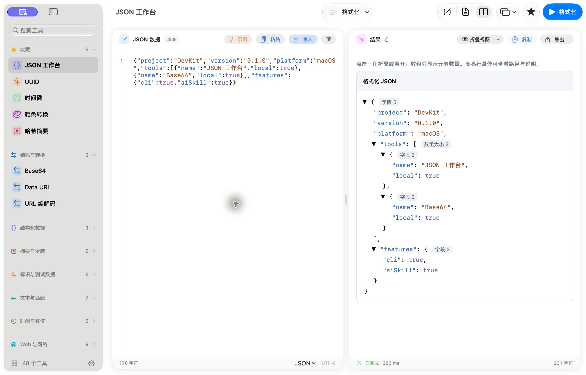

# DevKit for macOS

面向 Web 开发者的 macOS 工具箱，提供编码转换、JSON、文本处理、日期计算、网络调试和图片处理工具。

[下载](https://github.com/luolayo/devkit-macos/releases/latest) · [使用手册](https://luolayo.github.io/devkit-macos/)



## 安装

支持 macOS 26 及以上，提供 Apple Silicon 和 Intel 通用包。

从 [Releases](https://github.com/luolayo/devkit-macos/releases/latest) 下载应用压缩包，解压后将 `DevKit.app` 放入「应用程序」。

## 工具

| 类别 | 工具 |
| --- | --- |
| 编码与数据 | Base64、URL 编解码、Data URL、JSON 工作台 |
| 摘要与令牌 | 哈希、HMAC、文件校验、JWT、证书解析 |
| 生成与文本 | UUID、ULID、Nano ID、Mock 数据、正则、文本对比与统计 |
| 日期与数值 | 时间戳、时区转换、Cron、进制、数字格式与单位换算 |
| Web 与网络 | URL、查询参数、Cookie、HTTP、WebSocket、DNS、cURL 转换 |
| 代码与图形 | 代码格式化与压缩、Markdown、SVG、二维码、图片与网站图标 |
| 前端样式 | 颜色转换、对比度、CSS 单位 |

支持工具搜索与收藏、语法高亮、输入与结果对照、独立窗口。完整操作见[工具手册](https://luolayo.github.io/devkit-macos/tools/)。

## CLI 与 AI

在「设置 → CLI 与 AI」安装 `devkit` 命令及 Codex / Claude Code Skill。

```sh
devkit list
devkit describe json
printf '%s' '{"hello":"DevKit"}' | devkit run json --format text
```

更多示例见 [CLI 与 AI 教程](https://luolayo.github.io/devkit-macos/cli-and-ai.html)。

## 开发

在 Xcode 中打开 `DevKit.xcodeproj`，选择 **DevKit / My Mac**，配置开发团队后按 **⌘R** 运行。

```sh
DEVKIT_LANGUAGE=zh-Hans swift test
```

[开发指南](.codex/docs/development.md) · [项目结构](.codex/docs/architecture.md) · [贡献约定](AGENTS.md)

## 翻译贡献

目前支持简体中文和英文，默认跟随系统语言；在设置中更改后，界面与菜单即时更新，保留当前输入和结果。代码和源文案统一使用英文，新增语言只需参考英文提供翻译 JSON，无需理解中文或修改业务代码；步骤见[多语言与翻译贡献](.codex/docs/localization.md)。
